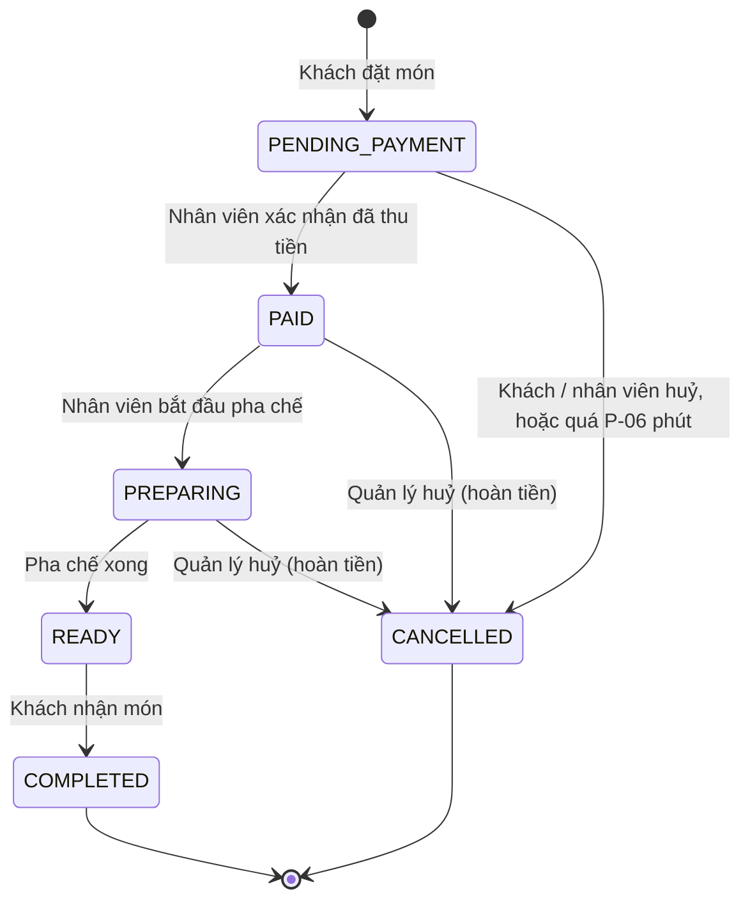
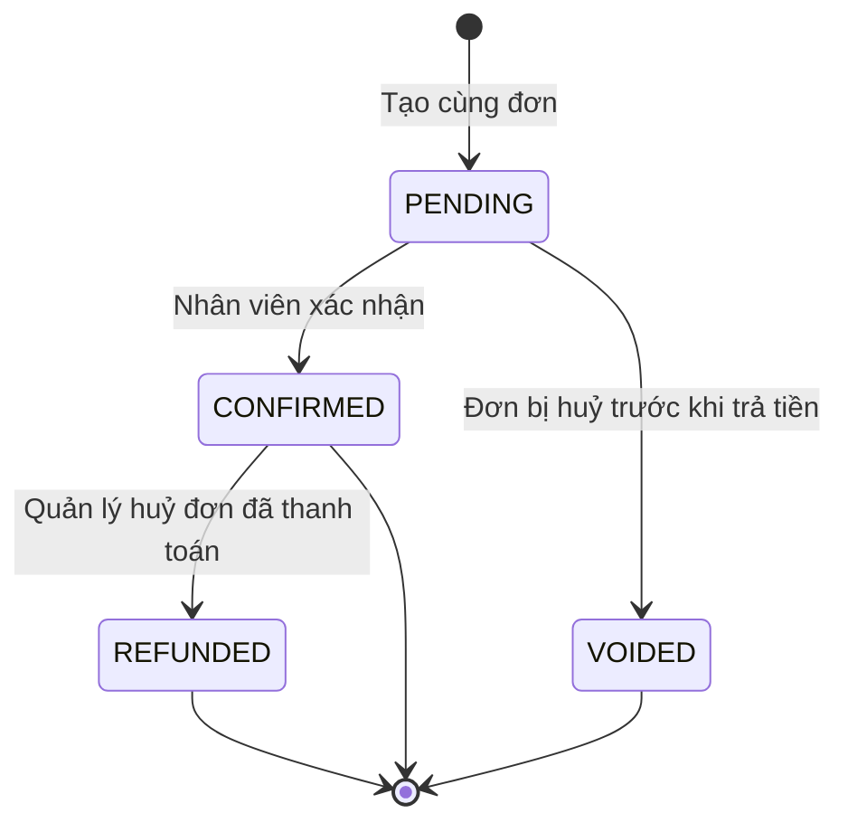
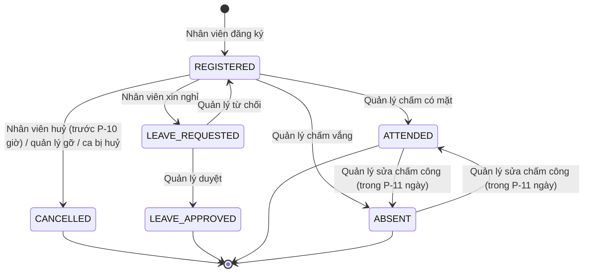

# 01 — Đặc tả yêu cầu hệ thống (SRS)

## 1. Tóm tắt

Drinkool là hệ thống đặt đồ uống cho **một quán cà phê duy nhất**. Khách xem menu, tự đặt món trên điện thoại rồi thanh toán bằng tiền mặt hoặc QR. Nhân viên nhận và pha chế đơn, đồng thời tự đăng ký ca làm. Quản lý (chủ quán) quản lý menu, xếp ca và xem doanh thu, lợi nhuận.

Hệ thống không có khái niệm nhiều quán: không có danh sách quán, không có `shop_id`, mọi nhân viên và quản lý đều thuộc quán này.

Frontend hiện tại đã có giao diện cho hầu hết các phần trên. Tuy vậy, khi đối chiếu với nghiệp vụ, có ba lỗ hổng lớn mà tài liệu này phải lấp:

1. **Chưa có khái niệm "đơn hàng".** Nút "Tiền mặt" và "QR Code" ở trang thanh toán chỉ mở hộp thoại đánh giá. Không có bản ghi nào được tạo ra, nên trang thống kê doanh thu không có nguồn dữ liệu thật và nhân viên cũng không biết có đơn mới.
2. **Trạng thái nghỉ phép và vắng mặt đang gắn ở ca, không gắn ở nhân viên.** Một ca có 3 người mà 1 người xin nghỉ thì hiện tại cả ca bị đánh dấu "nghỉ phép". Tài liệu tách thành bảng phân ca (`shift_assignment`).
3. **Thống kê đọc giá nhập và lợi nhuận từ dữ liệu giả.** Muốn tính lợi nhuận đúng thì giá vốn phải được lưu vào từng dòng đơn tại thời điểm bán, vì giá nhập sẽ thay đổi theo thời gian.

## 2. Mục tiêu nghiệp vụ

| ID | Mục tiêu | Cách đo | Mốc hiện tại → mục tiêu |
|---|---|---|---|
| G-1 | Khách tự đặt món, giảm thời gian chờ ở quầy | Thời gian trung bình từ lúc tạo đơn tới lúc xác nhận thanh toán | Chưa đo được → cần chốt (Q-01) |
| G-2 | Quản lý có số doanh thu và lợi nhuận đúng theo ngày, tuần, tháng, năm | Tổng doanh thu trên hệ thống lệch so với tiền thực thu cuối ngày | Chưa có dữ liệu → lệch 0 đ sau khi chốt ca |
| G-3 | Xếp ca không còn trùng lịch hoặc thiếu người | Số ca không đủ người tại giờ bắt đầu ca | Chưa đo được → cần chốt |
| G-4 | Chuẩn bị nối backend mà không phải sửa lại giao diện | Số page phải sửa khi thay mock bằng API thật | Mục tiêu: 0, chỉ sửa trong `lib/services/` |

## 3. Phạm vi

**Trong phạm vi:**
- Tài khoản: đăng ký khách bằng số điện thoại và OTP, đăng nhập cho khách, nhân viên và quản lý, đăng xuất.
- Xem menu của quán (món, combo, danh mục), tìm kiếm món.
- Tuỳ chọn món: size, mức đường, mức đá, topping. Mỗi lựa chọn có thể cộng thêm tiền. Quản lý tự định nghĩa nhóm tuỳ chọn và gắn vào từng món. Món trong combo cũng được chọn tuỳ chọn, riêng cho từng ly.
- Giỏ hàng, đặt món, chọn phương thức thanh toán (tiền mặt hoặc QR chuyển khoản), theo dõi trạng thái đơn, lịch sử đơn của khách.
- Nhân viên xử lý đơn: xác nhận đã thu tiền, pha chế, báo món xong, hoàn tất, huỷ.
- Đánh giá đơn (1–5 sao và bình luận).
- Quản lý menu: CRUD danh mục, món, combo, bật/tắt bán. Sửa thông tin quán.
- Ca làm: quản lý tạo, sửa, huỷ ca. Nhân viên đăng ký, huỷ đăng ký, xin nghỉ. Quản lý duyệt nghỉ và chấm công (có mặt hoặc vắng mặt).
- Báo cáo: doanh thu, số đơn, lợi nhuận, giá trị đơn trung bình, top món, tỷ trọng theo danh mục, chi phí nhân công theo tuần.

**Ngoài phạm vi (đề xuất cho giai đoạn sau):**
- Cổng thanh toán tự động (webhook ngân hàng hoặc VNPay, MoMo). Ở MVP, nhân viên tự xác nhận đã nhận tiền QR.
- Khuyến mãi, mã giảm giá, tích điểm.
- Giao hàng tận nơi.
- Quản lý kho nguyên liệu.
- Tính lương, bảo hiểm, thuế. Hệ thống chỉ tổng hợp chi phí ca theo mức lương mỗi ca.
- Phục vụ nhiều quán hoặc chuỗi quán. Nếu sau này mở thêm chi nhánh thì phải thêm lại bảng quán và cột `shop_id` cho menu, nhân viên, ca, đơn.
- Xuất hoá đơn điện tử.

## 4. Giả định

Mỗi giả định dưới đây, nếu sai, sẽ làm thay đổi thiết kế. Các câu hỏi tương ứng nằm ở mục 10.

| ID | Giả định | Nếu sai thì ảnh hưởng gì |
|---|---|---|
| A-1 | Khách đặt món **tại quán** (ngồi bàn hoặc mang đi), không có giao hàng | Nếu có giao hàng thì phải thêm địa chỉ, phí ship và trạng thái giao |
| A-2 | Khách vãng lai **được** đặt món. Muốn xem lịch sử đơn và đánh giá thì phải đăng nhập | Nếu bắt buộc đăng nhập thì UC-07 thêm bước đăng nhập và `customer_order.customer_id` thành bắt buộc |
| A-3 | Thanh toán **trả trước**: đơn chỉ được pha chế sau khi nhân viên xác nhận đã thu tiền | Nếu cho trả sau thì máy trạng thái đơn đổi thứ tự (PREPARING trước PAID) |
| A-4 | Tiền QR được nhân viên **xác nhận thủ công** khi thấy tiền về | Nếu tích hợp cổng thanh toán thì thêm webhook, đối soát và trạng thái PROCESSING |
| A-5 | Hệ thống chỉ phục vụ **một quán**. Thông tin quán là một bản ghi cấu hình duy nhất, được tạo sẵn lúc cài đặt | Nếu mở thêm chi nhánh thì phải thêm bảng `shop` và `shop_id` cho gần như mọi bảng |
| A-7 | Không có tồn kho: món đang bật bán thì đặt được, không giới hạn số lượng | Nếu cần trừ tồn thì thêm bảng tồn kho và rule giữ chỗ |
| A-8 | Tiền tệ duy nhất là VND, lưu bằng số nguyên (đồng), không có số lẻ | — |
| A-9 | Lương ca là **mức cố định mỗi ca** (như frontend hiện tại), không tính theo giờ | Nếu tính theo giờ thì `wage` đổi thành đơn giá giờ và phải chấm giờ vào, giờ ra |
| A-10 | Trong combo, lựa chọn tính **theo từng đơn vị món** (Q-07 đã chốt): combo có 2 Trà Đào thì khách chọn riêng cho ly 1 và ly 2. Mọi combo trên cùng một dòng giỏ dùng chung bộ lựa chọn đó | Nếu quán muốn một bộ lựa chọn chung cho mọi ly cùng món trong combo thì gộp theo `product_id` thay cho `component_no` |

## 5. Actor và phân quyền

| Actor | Mô tả |
|---|---|
| Khách vãng lai (Guest) | Chưa đăng nhập |
| Khách hàng (Customer) | Đã đăng ký bằng số điện thoại |
| Nhân viên (Staff) | Nhân viên của quán, đăng nhập bằng tên đăng nhập |
| Quản lý (Manager) | Chủ quán hoặc người được giao quản lý quán. Có mọi quyền của nhân viên |
| Hệ thống (System) | Job nền: huỷ đơn quá hạn thanh toán (BR-28), trả yêu cầu nghỉ chưa duyệt về `REGISTERED` khi ca bắt đầu (BR-48), dọn OTP hết hạn |

| Chức năng | Guest | Customer | Staff | Manager |
|---|:-:|:-:|:-:|:-:|
| Xem thông tin quán, xem menu | ✓ | ✓ | ✓ | ✓ |
| Đặt món, theo dõi đơn vừa đặt | ✓ | ✓ | – | – |
| Xem lịch sử đơn của mình, đánh giá | – | ✓ | – | – |
| Xem và xử lý đơn | – | – | ✓ | ✓ |
| Tạm tắt bán một món khi hết nguyên liệu | – | – | ✓ | ✓ |
| Tạm tắt một tuỳ chọn khi hết (ví dụ hết trân châu) | – | – | ✓ | ✓ |
| Huỷ đơn đã thanh toán (hoàn tiền) | – | – | – | ✓ |
| CRUD danh mục, món, combo, nhóm tuỳ chọn; sửa thông tin quán | – | – | – | ✓ |
| Xem lịch ca, đăng ký ca, xin nghỉ | – | – | ✓ | ✓ |
| Tạo, sửa, huỷ ca; duyệt nghỉ; chấm công | – | – | – | ✓ |
| Xem báo cáo doanh thu, lợi nhuận, chi phí ca | – | – | – | ✓ |

## 6. Yêu cầu chức năng

Mỗi FR truy vết về use case trong [03-usecase.md](03-usecase.md) và về rule trong [02-business-rules.md](02-business-rules.md).

### 6.1 Tài khoản

| ID | Yêu cầu | UC | BR |
|---|---|---|---|
| FR-01 | Khách nhập số điện thoại Việt Nam hợp lệ, nhận OTP và đặt mật khẩu để tạo tài khoản | UC-01 | BR-01, BR-02 |
| FR-02 | Đăng nhập: khách dùng số điện thoại, nhân viên và quản lý dùng tên đăng nhập. Sai quá P-04 lần thì khoá tạm thời | UC-02 | BR-04 |
| FR-03 | Đăng xuất, thu hồi phiên | UC-02 | — |
| FR-04 | Sau khi đăng nhập, mỗi role được đưa về trang chính của mình: Customer về trang chủ `/` (menu), Staff về `/staff/orders`, Manager về `/manager` | UC-02 | — |

### 6.2 Quán và menu

| ID | Yêu cầu | UC | BR |
|---|---|---|---|
| FR-06 | Xem thông tin quán và menu theo danh mục ngay ở trang chủ. Chỉ hiện món và combo đang bán, có tìm kiếm theo tên và mô tả | UC-04, UC-06 | BR-10, BR-13 |
| FR-07 | Quản lý thêm, sửa, xoá danh mục (tên, icon, thứ tự) | UC-12 | BR-11 |
| FR-08 | Quản lý thêm, sửa, xoá món (tên, danh mục, giá bán, giá vốn, ảnh, mô tả) và bật/tắt bán | UC-13 | BR-10, BR-12, BR-14 |
| FR-09 | Quản lý thêm, sửa, xoá combo gồm ≥ 2 món kèm số lượng, có giá riêng, bật/tắt bán | UC-14 | BR-13, BR-14 |
| FR-10 | Quản lý sửa thông tin quán: tên, khẩu hiệu, địa chỉ, giờ mở cửa, wifi, mạng xã hội | UC-15 | — |
| FR-34 | Quản lý thêm, sửa, xoá nhóm tuỳ chọn (ví dụ Size, Mức đường, Mức đá, Topping): tên, kiểu chọn một hoặc chọn nhiều, số lựa chọn tối thiểu và tối đa, danh sách giá trị kèm giá chênh, giá vốn chênh và giá trị mặc định. Gắn một hoặc nhiều nhóm vào từng món. Nhân viên được tạm tắt một giá trị khi hết nguyên liệu | UC-25, UC-13 | BR-16, BR-17, BR-19 |

FR-05 (tìm quán) đã bỏ khi hệ thống chuyển sang một quán. Mã không dùng lại.

### 6.3 Đặt món và thanh toán

| ID | Yêu cầu | UC | BR |
|---|---|---|---|
| FR-11 | Giỏ hàng lưu trên thiết bị: thêm, bớt, đổi số lượng, xoá món | UC-05 | BR-23 |
| FR-35 | Khi thêm một món có nhóm tuỳ chọn, khách chọn tuỳ chọn trong hộp thoại. Giá trị mặc định được chọn sẵn, giá cập nhật ngay theo lựa chọn, nút thêm vào giỏ bị khoá cho tới khi đủ nhóm bắt buộc. Cùng món nhưng khác lựa chọn là hai dòng giỏ riêng, cùng lựa chọn thì cộng dồn số lượng | UC-05 | BR-16, BR-18, BR-19 |
| FR-12 | Đặt món: gửi giỏ hàng, phương thức thanh toán và số bàn (tuỳ chọn). Hệ thống kiểm lại giá và tình trạng bán, đóng băng giá vào đơn, rồi trả về mã đơn | UC-07 | BR-21, BR-22, BR-23, BR-24 |
| FR-13 | Nếu chọn QR, hiện mã QR chuyển khoản kèm số tiền và nội dung là mã đơn | UC-07 | BR-25 |
| FR-36 | Lựa chọn của từng dòng (ví dụ "Size L, 50% đường, Trân châu") được chụp vào đơn và hiện ở mọi nơi hiển thị dòng đơn: giỏ, trang thanh toán, chi tiết đơn của khách, hàng đợi của nhân viên | UC-07, UC-08, UC-10 | BR-17, BR-18 |
| FR-37 | Khi thêm một combo có món mang nhóm tuỳ chọn, khách chọn tuỳ chọn cho từng ly trong combo (ví dụ ly 1 Trà Đào 50% đường, ly 2 Trà Đào ít đá) trong cùng hộp thoại. Giá combo cộng thêm giá chênh của mọi ly. Món trong combo không có nhóm tuỳ chọn thì không hiện trong hộp thoại | UC-05 | BR-17, BR-18, BR-23 |
| FR-14 | Khách xem trạng thái đơn của mình theo thời gian thực (polling mỗi P-07 giây) | UC-08 | — |
| FR-15 | Khách đã đăng nhập xem lịch sử đơn | UC-09 | — |
| FR-16 | Nhân viên xem hàng đợi đơn theo trạng thái | UC-10 | — |
| FR-17 | Nhân viên xác nhận đã thu tiền, bắt đầu pha chế, báo xong, hoàn tất đơn | UC-10 | BR-26, BR-27 |
| FR-18 | Huỷ đơn: khách tự huỷ khi đơn chưa thanh toán. Nhân viên huỷ đơn chưa thanh toán. Chỉ quản lý huỷ được đơn đã thanh toán, kèm lý do | UC-11 | BR-28, BR-29 |
| FR-19 | Hệ thống tự huỷ đơn chưa thanh toán sau P-06 phút | UC-11 | BR-28 |

### 6.4 Đánh giá

| ID | Yêu cầu | UC | BR |
|---|---|---|---|
| FR-20 | Khách đánh giá đơn đã hoàn tất của mình: 1–5 sao và bình luận tuỳ chọn, mỗi đơn một lần | UC-16 | BR-30, BR-31 |
| FR-21 | Quản lý xem danh sách đánh giá và điểm trung bình | UC-17 | — |

### 6.5 Ca làm

| ID | Yêu cầu | UC | BR |
|---|---|---|---|
| FR-22 | Xem lịch ca theo tuần, theo tháng và dạng danh sách trên mobile; lọc theo bộ phận | UC-18 | — |
| FR-23 | Quản lý tạo ca: ngày, giờ bắt đầu, giờ kết thúc, bộ phận, số người tối đa, lương mỗi ca | UC-19 | BR-40, BR-41 |
| FR-24 | Quản lý sửa hoặc huỷ ca. Huỷ ca đã có người đăng ký thì phải báo cho họ | UC-19 | BR-42 |
| FR-25 | Nhân viên đăng ký ca còn chỗ, không trùng giờ, chưa bắt đầu | UC-20 | BR-43, BR-44, BR-45, BR-46 |
| FR-26 | Nhân viên huỷ đăng ký trước giờ bắt đầu ít nhất P-10 giờ. Sát giờ hơn thì phải xin nghỉ | UC-20 | BR-47 |
| FR-27 | Nhân viên xin nghỉ một ca đã đăng ký, kèm lý do. Quản lý duyệt hoặc từ chối | UC-21 | BR-48 |
| FR-28 | Quản lý chấm công sau ca: có mặt hoặc vắng mặt | UC-22 | BR-49 |
| FR-29 | Quản lý gỡ một nhân viên khỏi ca | UC-19 | BR-42 |

### 6.6 Báo cáo

| ID | Yêu cầu | UC | BR |
|---|---|---|---|
| FR-30 | Tổng quan theo kỳ (ngày, tuần, tháng, năm): doanh thu, số đơn, lợi nhuận gộp, giá trị đơn trung bình, so với kỳ trước | UC-23 | BR-50, BR-51 |
| FR-31 | Biểu đồ doanh thu theo thời gian, so sánh hai nửa kỳ, tỷ trọng doanh thu theo danh mục | UC-23 | BR-50 |
| FR-32 | Bảng phân tích theo món: số lượng bán, doanh thu, giá vốn, giá bán, lợi nhuận, biên lợi nhuận; lọc theo danh mục, sắp xếp được | UC-23 | BR-51 |
| FR-33 | Chi phí nhân công theo tuần: tổng lương các phân ca hợp lệ | UC-24 | BR-52 |

### 6.7 User story và tiêu chí chấp nhận cho các luồng rủi ro cao

**US-07 — Là khách, tôi muốn đặt món ngay trên điện thoại để không phải xếp hàng ở quầy.**
- Given giỏ có 2 Cà Phê Sữa giá 30.000 đ, When khách bấm "Đặt món" với phương thức QR, Then hệ thống tạo đơn trạng thái `PENDING_PAYMENT`, tổng 60.000 đ, hiển thị mã đơn và mã QR.
- Given quản lý vừa tăng giá Cà Phê Sữa lên 32.000 đ sau khi khách đã thêm vào giỏ, When khách đặt món, Then hệ thống trả lỗi `BR-22` kèm giá mới. Giao diện cập nhật giỏ và yêu cầu khách xác nhận lại tổng tiền.
- Given một món trong giỏ vừa bị tắt bán, When khách đặt món, Then hệ thống trả lỗi `BR-21` kèm danh sách món không còn bán. Không có đơn nào được tạo.
- Given Trà sữa giá 35.000 đ có nhóm Size (M +0 đ, L +6.000 đ, bắt buộc) và Topping (Trân châu +5.000 đ, tối đa 3), When khách chọn Size L và Trân châu rồi đặt 2 ly, Then dòng đơn có đơn giá 46.000 đ, thành tiền 92.000 đ và ghi "Size L, Trân châu" (BR-17).
- Given trân châu vừa bị nhân viên tạm tắt sau khi khách đã thêm vào giỏ, When khách đặt món, Then hệ thống trả lỗi `BR-21` chỉ ra dòng và tuỳ chọn không còn bán. Không có đơn nào được tạo.
- Given Combo Trà Sữa Nhóm giá 130.000 đ gồm 2 Trà Đào và 2 Matcha, When khách chọn Size L cho ly Trà Đào thứ nhất và Trân châu đen cho ly Matcha thứ hai, Then dòng combo có đơn giá 141.000 đ và ghi lựa chọn dưới đúng từng ly (BR-17, FR-37).
- Given mạng chập chờn khiến khách bấm "Đặt món" hai lần với cùng `Idempotency-Key`, When request thứ hai tới, Then hệ thống trả lại đúng đơn đã tạo, không tạo đơn thứ hai (BR-24).

**US-10 — Là nhân viên, tôi muốn xác nhận khách đã trả tiền để bắt đầu pha chế.**
- Given đơn `PENDING_PAYMENT` phương thức tiền mặt, When nhân viên bấm "Đã thu tiền", Then đơn chuyển sang `PAID`, lưu người xác nhận và thời điểm.
- Given hai nhân viên cùng bấm xác nhận một đơn, When request thứ hai tới, Then hệ thống trả lỗi `BR-27` (đơn đã đổi trạng thái), không ghi nhận thanh toán hai lần.
- Given đơn đã bị hệ thống tự huỷ vì quá hạn, When nhân viên bấm "Đã thu tiền", Then hệ thống trả lỗi `BR-26`. Nhân viên phải tạo đơn mới cho khách.

**US-20 — Là nhân viên, tôi muốn đăng ký ca trống để có lịch làm việc.**
- Given ca Bar 07:00–11:00 còn 1 chỗ, When nhân viên An đăng ký, Then An có phân ca trạng thái `REGISTERED` và ca hết chỗ.
- Given An đã có ca Kitchen 08:00–12:00 cùng ngày, When An đăng ký ca Bar 07:00–11:00, Then hệ thống từ chối với `BR-45`.
- Given ca bắt đầu sau 3 giờ nữa và P-10 = 12 giờ, When An huỷ đăng ký, Then hệ thống từ chối với `BR-47` và gợi ý gửi yêu cầu xin nghỉ.
- Given hai nhân viên cùng đăng ký chỗ cuối cùng của một ca, When cả hai request tới gần như cùng lúc, Then chỉ một người thành công, người còn lại nhận lỗi `BR-43`.

## 7. Vòng đời trạng thái

### 7.1 Đơn hàng (`customer_order.status`)

| Từ | Đến | Ai kích hoạt | Điều kiện | Đảo ngược được? |
|---|---|---|---|---|
| — | PENDING_PAYMENT | Guest, Customer | Qua BR-21 đến BR-24 | — |
| PENDING_PAYMENT | PAID | Staff, Manager | Đơn chưa quá hạn | Không. Muốn sửa phải huỷ và hoàn tiền |
| PENDING_PAYMENT | CANCELLED | Chủ đơn, Staff, Manager, System | — | Không |
| PAID / PREPARING | CANCELLED | Manager | Bắt buộc có lý do; ghi audit; tạo bản ghi hoàn tiền | Không |
| PAID | PREPARING | Staff, Manager | — | Không |
| PREPARING | READY | Staff, Manager | — | Không |
| READY | COMPLETED | Staff, Manager | — | Không |

`COMPLETED` và `CANCELLED` là trạng thái cuối. Chỉ đơn đã sang `PAID` mới được tính vào doanh thu (BR-50).

### 7.2 Thanh toán (`payment.status`)

### 7.3 Phân ca (`shift_assignment.status`)

Phân ca ở trạng thái `CANCELLED` hoặc `LEAVE_APPROVED` **trả lại chỗ trống** cho ca (BR-43), để quản lý tìm người thay.

### 7.4 Ca (`shift.status`)

| Trạng thái | Ý nghĩa |
|---|---|
| `OPEN` | Đang nhận đăng ký |
| `CANCELLED` | Quản lý huỷ. Mọi phân ca còn hiệu lực chuyển sang `CANCELLED` |

"Đã đủ người" **không** phải một trạng thái lưu trong DB. Giá trị này được tính từ số phân ca đang chiếm chỗ so với `max_staff`, để không bao giờ lệch với dữ liệu thật.

## 8. Yêu cầu phi chức năng

| ID | Yêu cầu | Cách kiểm |
|---|---|---|
| NFR-01 | API đọc (menu, lịch ca) phản hồi dưới 300 ms cho 95% request; API ghi dưới 500 ms | Đo bằng log gateway |
| NFR-02 | Mật khẩu băm bằng bcrypt hoặc argon2. OTP chỉ lưu bản băm | Review code |
| NFR-03 | Mọi thao tác liên quan tới tiền (xác nhận thanh toán, huỷ đơn đã thanh toán, sửa giá) và chấm công đều ghi `audit_log`, không ai sửa được bản ghi | Kiểm DB |
| NFR-04 | Lỗi nghiệp vụ trả `application/problem+json` (RFC 9457), có trường `rule` là mã BR | Test API |
| NFR-05 | Giao diện chạy tốt ở chiều rộng 360 px trở lên; khách đặt món được hoàn toàn trên điện thoại | Test thủ công trên mobile |
| NFR-06 | Giờ hệ thống thống nhất theo múi giờ `Asia/Ho_Chi_Minh`; DB lưu `timestamptz` | Review schema |
| NFR-07 | Dữ liệu cá nhân (số điện thoại) chỉ hiển thị đầy đủ cho chính chủ. Nhân viên chỉ thấy 3 số cuối | Test phân quyền |

## 9. Rủi ro và điểm cần lưu ý

- **Xác nhận QR thủ công dễ sai.** Nhân viên có thể bấm "Đã thu tiền" khi tiền chưa về. MVP chấp nhận rủi ro này nhưng phải ghi audit người xác nhận. Nếu sai lệch nhiều thì cần làm sớm phần tích hợp cổng thanh toán (Q-03).
- **Đổi giá khi khách đang có món trong giỏ.** Giỏ lưu trên thiết bị nên giá có thể cũ. Backend luôn kiểm lại giá (BR-22). Giao diện phải xử lý lỗi này gọn, không làm khách mất giỏ.
- **Xoá món đã từng bán.** Đơn cũ vẫn tham chiếu tới món. Vì vậy xoá là xoá mềm (`deleted_at`), và tên, giá được chụp vào `order_item` (BR-14).
- **Hai nhân viên tranh chỗ cuối của một ca.** Phải khoá ở DB (`SELECT … FOR UPDATE` trên ca) hoặc dùng ràng buộc đếm. Kiểm tra ở frontend là không đủ.
- **Sửa ca đã có người đăng ký.** Nếu giảm `max_staff` xuống dưới số người đã đăng ký, hoặc đổi giờ làm phát sinh trùng lịch, hệ thống phải chặn (BR-41, BR-42).
- **Lộ thông tin số điện thoại đã đăng ký.** Bước gửi OTP báo "số đã có tài khoản" giúp người lạ dò xem một số có dùng Drinkool không. MVP chấp nhận để khách dễ hiểu, nhưng P-01 phải được áp cả theo IP để chặn dò hàng loạt.
- **Đổi giá vốn làm thay đổi lợi nhuận quá khứ.** Không được tính lại. Lợi nhuận luôn dùng `unit_cost` đã chụp lúc bán (BR-51).

## 10. Câu hỏi mở

Xếp theo mức ảnh hưởng tới thiết kế. Trong lúc chờ chốt, thiết kế dùng phương án in đậm.

Q-05 đã bỏ cùng khái niệm nhiều quán. Mã không dùng lại.

1. **Q-01 — Khách có bắt buộc đăng nhập khi đặt món không?** Ảnh hưởng tới UC-07, tới việc `customer_id` có được để trống không, và tới chống spam đơn ảo. *(a) **Không bắt buộc** — (b) Bắt buộc — (c) Bắt buộc từ đơn thứ 2*
2. **Q-02 — Thanh toán trước hay sau khi pha chế?** Quyết định thứ tự trạng thái đơn. *(a) **Trả trước** — (b) Trả sau, tại bàn — (c) Cả hai, quán tự cấu hình*
3. **Q-03 — Có cần tích hợp cổng thanh toán QR tự động ở giai đoạn 1 không?** Nếu có thì thêm webhook, đối soát và trạng thái `PROCESSING`. *(a) **Không, xác nhận thủ công** — (b) VietQR kèm webhook ngân hàng — (c) VNPay hoặc MoMo*
4. **Q-04 — Lương ca tính cố định theo ca hay theo giờ?** Ảnh hưởng tới `shift.wage` và chi phí nhân công. *(a) **Cố định theo ca** — (b) Theo giờ, chấm giờ vào/ra*
5. **Q-06 — Có cho sửa món trong đơn sau khi đã thanh toán không (đổi món vì hết nguyên liệu)?** Nếu có, cần lệnh sửa dòng đơn, tính chênh lệch và hoàn tiền một phần. *(a) **Không, huỷ đơn rồi đặt lại** — (b) Cho đổi sang món cùng giá — (c) Cho đổi tuỳ ý, xử lý chênh lệch*
6. **Q-07 — Món trong combo có cho chọn tuỳ chọn (size, topping) không?** Ảnh hưởng tới `order_item_option` và cách tính giá combo. *(a) Không, pha theo mặc định — (b) **Cho chọn, cộng giá chênh vào dòng combo***. **Đã chốt (b) ngày 14/11/2026**, chọn theo từng ly (A-10, FR-37).
