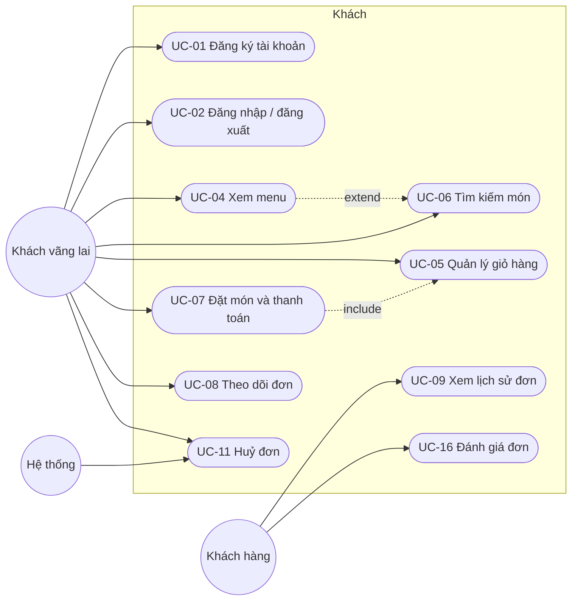
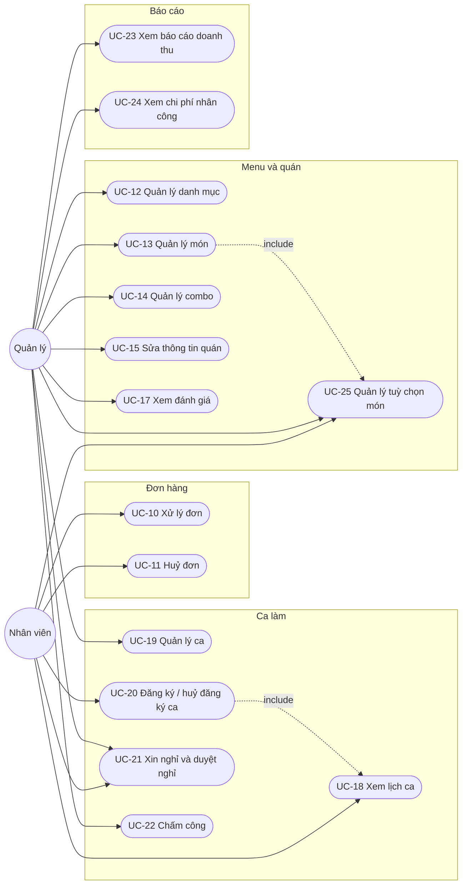

# 03 — Use case

## 1. Sơ đồ use case

Mermaid chưa có kiểu sơ đồ use case riêng. Sơ đồ dưới đây dùng `flowchart`: hình tròn là actor, hình bo tròn là use case, mũi tên nét liền là actor thực hiện use case. Quan hệ kế thừa giữa các actor không vẽ để sơ đồ đỡ rối: Customer làm được mọi việc của Guest, và Manager làm được mọi việc của Staff.

Mã UC-03 (Tìm quán) đã bỏ khi hệ thống chuyển sang phục vụ một quán. Các mã khác giữ nguyên để không phải đánh số lại tài liệu.

### 1.1 Phía khách

### 1.2 Phía quán

## 2. Danh sách use case

| ID | Tên | Actor chính | FR | Màn hình frontend |
|---|---|---|---|---|
| UC-01 | Đăng ký tài khoản | Guest | FR-01 | `/register` |
| UC-02 | Đăng nhập / đăng xuất | Mọi actor | FR-02, FR-03, FR-04 | `/login`, header |
| UC-04 | Xem menu | Guest | FR-06 | `/` (trang chủ) |
| UC-05 | Quản lý giỏ hàng | Guest | FR-11, FR-35 | `/`, `/checkout` |
| UC-06 | Tìm kiếm món | Guest | FR-06 | `/` |
| UC-07 | Đặt món và thanh toán | Guest | FR-12, FR-13, FR-36 | `/checkout` |
| UC-08 | Theo dõi đơn | Guest | FR-14, FR-36 | `/orders/[orderId]` |
| UC-09 | Xem lịch sử đơn | Customer | FR-15 | `/orders` |
| UC-10 | Xử lý đơn | Staff | FR-16, FR-17, FR-36 | `/staff/orders` |
| UC-11 | Huỷ đơn | Guest, Staff, Manager, System | FR-18, FR-19 | `/orders/[orderId]`, `/staff/orders` |
| UC-12 | Quản lý danh mục | Manager | FR-07 | `/manager` (tab Danh mục) |
| UC-13 | Quản lý món | Manager | FR-08, FR-34 | `/manager` (tab Thực đơn) |
| UC-14 | Quản lý combo | Manager | FR-09 | `/manager` (tab Combo) |
| UC-15 | Sửa thông tin quán | Manager | FR-10 | `/manager` (tab Thông tin quán) |
| UC-16 | Đánh giá đơn | Customer | FR-20 | `/orders/[orderId]` |
| UC-17 | Xem đánh giá | Manager | FR-21 | `/manager` (tab Đánh giá) |
| UC-18 | Xem lịch ca | Staff | FR-22 | `/staff/schedule` |
| UC-19 | Quản lý ca | Manager | FR-23, FR-24, FR-29 | `/staff/schedule` |
| UC-20 | Đăng ký / huỷ đăng ký ca | Staff | FR-25, FR-26 | `/staff/schedule` |
| UC-21 | Xin nghỉ và duyệt nghỉ | Staff, Manager | FR-27 | `/staff/schedule` |
| UC-22 | Chấm công | Manager | FR-28 | `/staff/schedule` |
| UC-23 | Xem báo cáo doanh thu | Manager | FR-30, FR-31, FR-32 | `/manager/analytics` |
| UC-24 | Xem chi phí nhân công | Manager | FR-33 | `/staff/schedule` (ô Ngân sách tuần) |
| UC-25 | Quản lý tuỳ chọn món | Manager (Staff chỉ bật/tắt giá trị) | FR-34 | `/manager` (tab Tuỳ chọn), `/staff/orders` (ô Tuỳ chọn đang hết) |

## 3. Đặc tả use case chính

### UC-05 — Thêm món có tuỳ chọn vào giỏ

| Mục | Nội dung |
|---|---|
| Actor | Khách vãng lai, Khách hàng |
| Mục tiêu | Chọn size, đường, đá, topping cho một món rồi thêm vào giỏ |
| Tiền điều kiện | Món đang bán và có ít nhất một nhóm tuỳ chọn |
| Hậu điều kiện thành công | Giỏ có một dòng mang đúng lựa chọn và đơn giá đã cộng giá chênh |

**Luồng chính**
1. Khách bấm "Thêm" ở một món có tuỳ chọn. Hệ thống mở hộp thoại, liệt kê các nhóm theo thứ tự đã gắn, chọn sẵn giá trị mặc định (BR-16).
2. Khách đổi lựa chọn. Giá trên nút cập nhật ngay: giá món + Σ giá chênh, nhân số lượng (BR-17).
3. Khách bấm "Thêm vào giỏ". Nếu giỏ đã có dòng cùng món, cùng lựa chọn thì cộng dồn số lượng, nếu không thì tạo dòng mới (BR-23).

**Luồng thay thế**
- 1a. Món không có nhóm tuỳ chọn: thêm thẳng vào giỏ, không mở hộp thoại.
- 2a. Nhóm `MULTIPLE` đã đủ `max_select`: các giá trị chưa chọn bị khoá cho tới khi khách bỏ bớt.

**Luồng ngoại lệ**
- 2b. Chưa chọn đủ nhóm bắt buộc: nút "Thêm vào giỏ" bị khoá và nhóm thiếu được đánh dấu.
- 1b. Giá trị đang tạm hết: hiện mờ kèm nhãn "Hết", không chọn được (BR-19).

### UC-07 — Đặt món và thanh toán

| Mục | Nội dung |
|---|---|
| Actor | Khách vãng lai, Khách hàng |
| Mục tiêu | Tạo đơn và trả tiền để quán pha chế |
| Tiền điều kiện | Giỏ hàng có ít nhất 1 món |
| Hậu điều kiện thành công | Có đơn `PENDING_PAYMENT` kèm thanh toán `PENDING`. Khách thấy mã đơn và (nếu chọn QR) mã QR |
| Kích hoạt | Khách bấm "Đặt món" ở trang thanh toán |

**Luồng chính**
1. Khách mở `/checkout`. Hệ thống hiển thị các dòng trong giỏ và tổng tiền.
2. Khách chọn phương thức thanh toán (Tiền mặt hoặc QR), có thể nhập số bàn và ghi chú.
3. Khách bấm "Đặt món". Frontend sinh `Idempotency-Key` cho lần đặt này và gửi `POST /api/v1/orders`.
4. Hệ thống kiểm tra: từng món, combo và tuỳ chọn đang bán (BR-21), lựa chọn hợp lệ (BR-18), giá khớp (BR-22), số lượng hợp lệ (BR-23).
5. Hệ thống tạo đơn, chụp tên, giá bán và giá vốn vào `order_item`, chụp tên nhóm, tên giá trị và giá chênh vào `order_item_option` (BR-17), sinh mã đơn (BR-25), tạo thanh toán `PENDING`.
6. Frontend xoá giỏ và chuyển sang `/orders/{orderId}`.
7. Nếu chọn QR: hiện mã QR với số tiền và nội dung là mã đơn. Nếu chọn tiền mặt: hiện hướng dẫn "Đọc mã đơn cho nhân viên tại quầy".
8. Màn hình tự cập nhật trạng thái (UC-08) cho tới khi nhân viên xác nhận đã thu tiền.

**Luồng thay thế**
- 2a. Khách đã đăng nhập: đơn gắn với `customer_id` để hiện trong lịch sử.
- 7a. Khách đổi ý về phương thức thanh toán trước khi trả tiền: nhân viên chọn đúng phương thức khi xác nhận (UC-10), hệ thống cập nhật `payment.method`.

**Luồng ngoại lệ**
- 4a. Có món đã tắt bán: trả 422 `BR-21` kèm danh sách. Frontend đánh dấu các dòng đó, khách xoá rồi đặt lại.
- 4b. Giá đã đổi: trả 409 `BR-22` kèm giá mới. Frontend cập nhật giỏ và hiện tổng mới, khách bấm đặt lại.
- 4c. Lựa chọn không hợp lệ (ví dụ thiếu nhóm Size, hoặc nhóm vừa bị gỡ khỏi món): trả 422 `BR-18`. Frontend đánh dấu dòng đó để khách chọn lại.
- 3a. Mất mạng sau khi gửi: frontend gửi lại với **cùng** `Idempotency-Key`, nhận lại đúng đơn cũ (BR-24).
- 8a. Quá P-06 phút chưa trả tiền: hệ thống huỷ đơn (BR-28), màn hình hiện "Đơn đã hết hạn thanh toán" và nút "Đặt lại" để đưa các món về giỏ.

### UC-10 — Xử lý đơn

| Mục | Nội dung |
|---|---|
| Actor | Nhân viên, Quản lý |
| Mục tiêu | Thu tiền, pha chế và giao món đúng đơn |
| Tiền điều kiện | Đã đăng nhập với role Staff hoặc Manager |
| Hậu điều kiện thành công | Đơn `COMPLETED`, thanh toán `CONFIRMED` |

**Luồng chính**
1. Nhân viên mở `/staff/orders`. Hệ thống hiện các đơn theo cột: Chờ thanh toán, Đã thanh toán, Đang pha chế, Sẵn sàng.
2. Khách đọc mã đơn hoặc đưa màn hình chuyển khoản. Nhân viên tìm đơn theo mã, chọn phương thức và bấm "Đã thu tiền". Đơn sang `PAID`.
3. Nhân viên bấm "Bắt đầu pha chế" và pha theo lựa chọn ghi dưới từng dòng (size, đường, đá, topping, FR-36). Đơn sang `PREPARING`.
4. Pha xong, nhân viên bấm "Xong món". Đơn sang `READY`, màn hình của khách báo "Món đã sẵn sàng".
5. Khách nhận món, nhân viên bấm "Hoàn tất". Đơn sang `COMPLETED`.

**Luồng ngoại lệ**
- 2a. Đơn đã bị huỷ hoặc đã được người khác xác nhận: trả 409 `BR-26` / `BR-27`. Màn hình tải lại đơn.
- 2b. Khách không trả tiền và bỏ đi: nhân viên bấm "Huỷ đơn" (chỉ được khi đơn còn `PENDING_PAYMENT`).
- 3a. Hết nguyên liệu sau khi đã thu tiền: nhân viên báo quản lý. Quản lý huỷ đơn có lý do và hoàn tiền (BR-29).

### UC-16 — Đánh giá đơn

| Mục | Nội dung |
|---|---|
| Actor | Khách hàng |
| Tiền điều kiện | Đơn `COMPLETED` của chính khách, chưa quá P-09 ngày, chưa có đánh giá |

**Luồng chính**
1. Ở `/orders/{orderId}` (hoặc trong lịch sử), khách bấm "Đánh giá".
2. Khách chọn 1–5 sao, nhập bình luận (tuỳ chọn) rồi gửi.
3. Hệ thống lưu đánh giá, nút "Đánh giá" đổi thành số sao đã chấm.

**Ngoại lệ:** đơn chưa hoàn tất, quá hạn hoặc đã đánh giá → 422 `BR-30` / `BR-31`.

> Ghi chú so với frontend cũ: trước đây nút "Đánh giá" nằm ở trang thanh toán, nên khách có thể đánh giá khi chưa mua gì. Đặc tả chuyển việc đánh giá sang sau khi đơn hoàn tất.

### UC-20 — Đăng ký / huỷ đăng ký ca

| Mục | Nội dung |
|---|---|
| Actor | Nhân viên (Quản lý cũng đăng ký được cho chính mình) |
| Tiền điều kiện | Ca `OPEN`, chưa bắt đầu, trong P-12 ngày tới |

**Luồng chính — đăng ký**
1. Nhân viên mở `/staff/schedule`, chọn một ca còn chỗ.
2. Hệ thống hiện chi tiết: giờ, bộ phận, lương, danh sách người đã đăng ký, số chỗ còn lại.
3. Nhân viên bấm "Đăng ký". Hệ thống khoá ca, kiểm BR-43 đến BR-46 rồi tạo phân ca `REGISTERED`.

**Luồng chính — huỷ đăng ký**
1. Nhân viên mở ca mình đã đăng ký, bấm "Huỷ đăng ký".
2. Ca còn ≥ P-10 giờ mới bắt đầu: phân ca sang `CANCELLED`, chỗ được trả lại.

**Ngoại lệ**
- 3a. Ca vừa hết chỗ: 409 `BR-43`, giao diện tải lại ca.
- 3b. Trùng giờ với ca khác: 422 `BR-45`, hiện tên ca bị trùng.
- 2a (huỷ). Còn dưới P-10 giờ: 422 `BR-47`, giao diện đưa sang form xin nghỉ (UC-21).

### UC-21 — Xin nghỉ và duyệt nghỉ

**Luồng chính**
1. Nhân viên mở ca đã đăng ký, bấm "Xin nghỉ", nhập lý do. Phân ca sang `LEAVE_REQUESTED`.
2. Quản lý thấy yêu cầu ở chi tiết ca (có nhãn "Chờ duyệt nghỉ").
3. Quản lý bấm "Duyệt": phân ca sang `LEAVE_APPROVED`, ca có thêm một chỗ trống. Hoặc bấm "Từ chối": phân ca về `REGISTERED`.

**Ngoại lệ:** ca bắt đầu mà quản lý chưa quyết định → hệ thống tự chuyển về `REGISTERED` (BR-48). Nếu nhân viên không tới, quản lý chấm `ABSENT` (UC-22).

### UC-23 — Xem báo cáo doanh thu

1. Quản lý mở `/manager/analytics`, chọn kỳ (ngày, tuần, tháng, năm).
2. Hệ thống trả số tổng quan và phần so sánh với kỳ trước (BR-50, BR-51, BR-53), chuỗi doanh thu theo thời gian, tỷ trọng theo danh mục và bảng theo món.
3. Quản lý lọc theo danh mục và sắp xếp bảng theo cột.

**Ngoại lệ:** kỳ không có đơn → các ô hiện 0 đ, phần so sánh hiện "—", biểu đồ hiện trạng thái trống.

### UC-25 — Quản lý tuỳ chọn món

| Mục | Nội dung |
|---|---|
| Actor | Quản lý. Nhân viên chỉ bật/tắt giá trị |
| Mục tiêu | Định nghĩa nhóm tuỳ chọn dùng chung và gắn vào món |
| Tiền điều kiện | Đã đăng nhập role Manager (hoặc Staff cho bước bật/tắt) |
| Hậu điều kiện thành công | Menu của khách hiện đúng nhóm và giá trị đang bán |

**Luồng chính**
1. Quản lý mở `/manager`, tab "Tuỳ chọn". Hệ thống liệt kê các nhóm, số món đang dùng mỗi nhóm.
2. Quản lý bấm "Thêm nhóm", nhập tên, kiểu chọn, số chọn tối thiểu và tối đa, rồi thêm các giá trị (tên, giá chênh, giá vốn chênh, mặc định).
3. Hệ thống kiểm BR-16, BR-17 rồi lưu nhóm.
4. Ở tab "Thực đơn", quản lý sửa một món và tick các nhóm muốn gắn (UC-13). Menu của khách hiện nhóm mới ngay ở lần tải sau.

**Luồng thay thế**
- 1a. Hết trân châu giữa ca: nhân viên mở ô "Tuỳ chọn đang hết" ở `/staff/orders` và tắt giá trị đó. Món vẫn bán, chỉ giá trị đó bị ẩn (BR-19).
- 2a. Sửa giá chênh: hệ thống ghi `audit_log` (BR-17). Đơn đã đặt giữ giá cũ.

**Luồng ngoại lệ**
- 3a. Nhóm bắt buộc kiểu chọn một mà không có giá trị mặc định, hoặc `min_select` > `max_select`: 422 `BR-16`.
- 3b. Giá chênh âm: 422 `BR-17`.
- 1b. Xoá nhóm hoặc giá trị đã từng bán: hệ thống xoá mềm (BR-19). Nhóm đang gắn vào món thì phải gỡ khỏi món trước, nếu không trả 422 `BR-19`.
