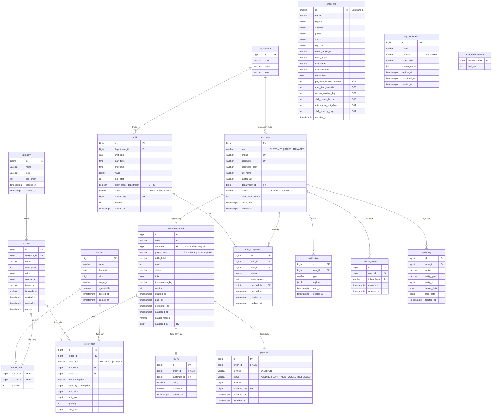

# 04 — Mô hình dữ liệu (ERD, PostgreSQL)

## 1. Sơ đồ ERD



## 2. Lý do thiết kế

- **`order_item` chụp lại tên, giá bán, giá vốn và danh mục** (`name_snapshot`, `unit_price`, `unit_cost`, `category_id_snapshot`). Đơn cũ phải giữ đúng như lúc bán, kể cả khi món bị đổi tên, đổi giá hay xoá mềm (BR-14). Báo cáo lợi nhuận dùng `unit_cost` đã chụp (BR-51), và tỷ trọng theo danh mục dùng `category_id_snapshot`. Dòng combo có `category_id_snapshot` để trống và `unit_cost` bằng tổng giá vốn của các món thành phần lúc bán.
- **`payment` tách khỏi `customer_order`.** Vòng đời thanh toán (hoàn tiền, huỷ trước khi trả) khác vòng đời đơn. Khi tích hợp cổng thanh toán (Q-03), chỉ cần thêm cột hoặc bảng giao dịch cổng mà không phải sửa bảng đơn. MVP là 1–1 (`order_id` unique).
- **Trạng thái nghỉ phép và vắng mặt nằm ở `shift_assignment`**, không nằm ở `shift`. Mỗi người trong cùng một ca có thể ở trạng thái khác nhau. "Đã đủ người" được tính từ số phân ca đang chiếm chỗ, không lưu.
- **`app_user` dùng chung cho mọi role.** Khách đăng nhập bằng `phone`, nhân viên bằng `username`. Ràng buộc kiểm tra bảo đảm Staff và Manager luôn có `username`, còn Customer luôn có `phone`.
- **`shop_info` chỉ có một dòng** (`CHECK (id = 1)`), chứa thông tin quán và các tham số P-06, P-08 → P-12 (P-07 là tham số kỹ thuật, nằm trong cấu hình backend). Hệ thống chỉ phục vụ một quán (A-5), nên không bảng nào có `shop_id`.
- **Tiền lưu bằng `bigint` (đồng).** VND không có số lẻ, dùng số nguyên thì tránh sai số làm tròn (A-8).
- **`order_daily_counter`** cấp số thứ tự trong ngày cho mã đơn (BR-25) bằng `INSERT … ON CONFLICT … DO UPDATE SET last_seq = last_seq + 1 RETURNING last_seq`. Cách này an toàn khi nhiều đơn được tạo cùng lúc.
- **`customer_order.guest_token`.** Khách vãng lai không có tài khoản, nên khi tạo đơn hệ thống trả về một token ngẫu nhiên. Token được lưu trên thiết bị để khách xem lại và huỷ đúng đơn của mình.
- **`version`** trên `customer_order` và `shift` dùng cho optimistic locking (BR-27). Ngoài ra, thao tác đăng ký ca khoá dòng `shift` bằng `SELECT … FOR UPDATE` để đếm chỗ chính xác (BR-43).

## 3. DDL tham khảo

```sql
-- A-5: hệ thống chỉ phục vụ một quán, bảng này luôn có đúng một dòng
CREATE TABLE shop_info (
    id                      smallint PRIMARY KEY DEFAULT 1 CHECK (id = 1),
    name                    varchar(120) NOT NULL,
    tagline                 varchar(200),
    address                 varchar(255) NOT NULL,
    phone                   varchar(15),
    email                   varchar(120),
    logo_url                varchar(500),
    cover_image_url         varchar(500),
    open_hours              varchar(100),
    wifi_name               varchar(64),
    wifi_password           varchar(64),
    social_links            jsonb NOT NULL DEFAULT '{}'::jsonb,
    payment_timeout_minutes int NOT NULL DEFAULT 15 CHECK (payment_timeout_minutes > 0),
    max_item_quantity       int NOT NULL DEFAULT 20 CHECK (max_item_quantity > 0),
    review_window_days      int NOT NULL DEFAULT 7  CHECK (review_window_days >= 0),
    shift_cancel_hours      int NOT NULL DEFAULT 12 CHECK (shift_cancel_hours >= 0),
    attendance_edit_days    int NOT NULL DEFAULT 3  CHECK (attendance_edit_days >= 0),
    shift_booking_days      int NOT NULL DEFAULT 14 CHECK (shift_booking_days > 0),
    updated_at              timestamptz NOT NULL DEFAULT now()
);

CREATE TABLE department (
    id   bigserial PRIMARY KEY,
    code varchar(32) NOT NULL UNIQUE,
    name varchar(80) NOT NULL,
    icon varchar(64)
);

CREATE TABLE app_user (
    id                 bigserial PRIMARY KEY,
    role               varchar(16)  NOT NULL CHECK (role IN ('CUSTOMER','STAFF','MANAGER')),
    phone              varchar(10)  UNIQUE CHECK (phone ~ '^0[35789][0-9]{8}$'),
    username           varchar(64)  UNIQUE,
    password_hash      varchar(100) NOT NULL,
    full_name          varchar(120) NOT NULL,
    avatar_url         varchar(500),
    department_id      bigint REFERENCES department(id),
    status             varchar(16)  NOT NULL DEFAULT 'ACTIVE' CHECK (status IN ('ACTIVE','LOCKED')),
    failed_login_count int          NOT NULL DEFAULT 0,
    locked_until       timestamptz,
    created_at         timestamptz  NOT NULL DEFAULT now(),
    -- Khách đăng nhập bằng số điện thoại, nhân sự bằng username
    CHECK (
        (role = 'CUSTOMER' AND phone IS NOT NULL AND department_id IS NULL)
     OR (role IN ('STAFF','MANAGER') AND username IS NOT NULL)
    )
);

CREATE TABLE otp_verification (
    id            bigserial PRIMARY KEY,
    phone         varchar(10) NOT NULL,
    purpose       varchar(16) NOT NULL CHECK (purpose IN ('REGISTER')),
    code_hash     varchar(100) NOT NULL,
    attempt_count int         NOT NULL DEFAULT 0,
    expires_at    timestamptz NOT NULL,
    consumed_at   timestamptz,
    created_at    timestamptz NOT NULL DEFAULT now()
);
CREATE INDEX idx_otp_phone_created ON otp_verification (phone, created_at DESC);

CREATE TABLE refresh_token (
    id         bigserial PRIMARY KEY,
    user_id    bigint       NOT NULL REFERENCES app_user(id),
    token_hash varchar(100) NOT NULL UNIQUE,
    expires_at timestamptz  NOT NULL,
    revoked_at timestamptz
);

CREATE TABLE category (
    id         bigserial PRIMARY KEY,
    name       varchar(80) NOT NULL,
    icon       varchar(64) NOT NULL,
    sort_order int         NOT NULL DEFAULT 0,
    deleted_at timestamptz,
    created_at timestamptz NOT NULL DEFAULT now()
);
-- Danh mục xoá mềm: món đã xoá mềm vẫn tham chiếu tới danh mục cũ để giữ lịch sử
CREATE UNIQUE INDEX uq_category_name ON category (lower(name)) WHERE deleted_at IS NULL;

CREATE TABLE product (
    id           bigserial PRIMARY KEY,
    category_id  bigint       NOT NULL REFERENCES category(id),
    name         varchar(120) NOT NULL,
    description  text         NOT NULL DEFAULT '',
    price        bigint       NOT NULL CHECK (price > 0),
    cost_price   bigint       NOT NULL DEFAULT 0 CHECK (cost_price >= 0),
    image_url    varchar(500),
    is_available boolean      NOT NULL DEFAULT true,
    deleted_at   timestamptz,
    created_at   timestamptz  NOT NULL DEFAULT now(),
    updated_at   timestamptz  NOT NULL DEFAULT now()
);
-- BR-12: tên món duy nhất, không phân biệt hoa thường, bỏ qua món đã xoá
CREATE UNIQUE INDEX uq_product_name ON product (lower(name)) WHERE deleted_at IS NULL;
CREATE INDEX idx_product_menu ON product (category_id) WHERE deleted_at IS NULL;

CREATE TABLE combo (
    id           bigserial PRIMARY KEY,
    name         varchar(120) NOT NULL,
    description  text         NOT NULL DEFAULT '',
    price        bigint       NOT NULL CHECK (price > 0),
    image_url    varchar(500),
    is_available boolean      NOT NULL DEFAULT true,
    deleted_at   timestamptz,
    created_at   timestamptz  NOT NULL DEFAULT now()
);

CREATE TABLE combo_item (
    combo_id   bigint NOT NULL REFERENCES combo(id) ON DELETE CASCADE,
    product_id bigint NOT NULL REFERENCES product(id),
    quantity   int    NOT NULL CHECK (quantity > 0),
    PRIMARY KEY (combo_id, product_id)
);

CREATE TABLE customer_order (
    id              bigserial PRIMARY KEY,
    code            varchar(24) NOT NULL UNIQUE,
    customer_id     bigint REFERENCES app_user(id),
    guest_token     varchar(64),
    table_label     varchar(16),
    note            varchar(300),
    status          varchar(20) NOT NULL CHECK (status IN
                      ('PENDING_PAYMENT','PAID','PREPARING','READY','COMPLETED','CANCELLED')),
    total           bigint      NOT NULL CHECK (total > 0),
    idempotency_key varchar(64) NOT NULL,
    version         int         NOT NULL DEFAULT 1,
    created_at      timestamptz NOT NULL DEFAULT now(),
    paid_at         timestamptz,
    completed_at    timestamptz,
    cancelled_at    timestamptz,
    cancel_reason   varchar(300),
    cancelled_by    bigint REFERENCES app_user(id),
    UNIQUE (idempotency_key),
    CHECK (customer_id IS NOT NULL OR guest_token IS NOT NULL)
);
CREATE INDEX idx_order_queue    ON customer_order (status, created_at);
CREATE INDEX idx_order_customer ON customer_order (customer_id, created_at DESC);
CREATE INDEX idx_order_paid     ON customer_order (paid_at) WHERE paid_at IS NOT NULL;

CREATE TABLE order_item (
    id                   bigserial PRIMARY KEY,
    order_id             bigint       NOT NULL REFERENCES customer_order(id),
    item_type            varchar(8)   NOT NULL CHECK (item_type IN ('PRODUCT','COMBO')),
    product_id           bigint REFERENCES product(id),
    combo_id             bigint REFERENCES combo(id),
    name_snapshot        varchar(120) NOT NULL,
    category_id_snapshot bigint,
    unit_price           bigint       NOT NULL CHECK (unit_price > 0),
    unit_cost            bigint       NOT NULL CHECK (unit_cost >= 0),
    quantity             int          NOT NULL CHECK (quantity > 0),
    line_total           bigint       NOT NULL,
    CHECK ((item_type = 'PRODUCT' AND product_id IS NOT NULL AND combo_id IS NULL)
        OR (item_type = 'COMBO'   AND combo_id IS NOT NULL AND product_id IS NULL)),
    CHECK (line_total = unit_price * quantity)
);
CREATE INDEX idx_order_item_order ON order_item (order_id);

CREATE TABLE payment (
    id           bigserial PRIMARY KEY,
    order_id     bigint      NOT NULL UNIQUE REFERENCES customer_order(id),
    method       varchar(8)  NOT NULL CHECK (method IN ('CASH','QR')),
    status       varchar(10) NOT NULL CHECK (status IN ('PENDING','CONFIRMED','VOIDED','REFUNDED')),
    amount       bigint      NOT NULL CHECK (amount > 0),
    confirmed_by bigint REFERENCES app_user(id),
    confirmed_at timestamptz,
    refunded_at  timestamptz
);

CREATE TABLE review (
    id          bigserial PRIMARY KEY,
    order_id    bigint      NOT NULL UNIQUE REFERENCES customer_order(id),
    customer_id bigint      NOT NULL REFERENCES app_user(id),
    rating      smallint    NOT NULL CHECK (rating BETWEEN 1 AND 5),
    comment     varchar(500),
    created_at  timestamptz NOT NULL DEFAULT now()
);
CREATE INDEX idx_review_created ON review (created_at DESC);

CREATE TABLE order_daily_counter (
    business_date date PRIMARY KEY,
    last_seq      int  NOT NULL
);

CREATE TABLE shift (
    id            bigserial PRIMARY KEY,
    department_id bigint      NOT NULL REFERENCES department(id),
    shift_date    date        NOT NULL,
    start_time    time        NOT NULL,
    end_time      time        NOT NULL,
    wage          bigint      NOT NULL CHECK (wage > 0),
    max_staff     int         NOT NULL CHECK (max_staff BETWEEN 1 AND 20),
    allow_cross_department boolean NOT NULL DEFAULT false,  -- BR-46
    status        varchar(10) NOT NULL DEFAULT 'OPEN' CHECK (status IN ('OPEN','CANCELLED')),
    created_by    bigint      NOT NULL REFERENCES app_user(id),
    version       int         NOT NULL DEFAULT 1,
    created_at    timestamptz NOT NULL DEFAULT now(),
    CHECK (end_time > start_time)                       -- BR-40
);
CREATE INDEX idx_shift_calendar ON shift (shift_date);

CREATE TABLE shift_assignment (
    id           bigserial PRIMARY KEY,
    shift_id     bigint      NOT NULL REFERENCES shift(id),
    staff_id     bigint      NOT NULL REFERENCES app_user(id),
    status       varchar(16) NOT NULL CHECK (status IN
                   ('REGISTERED','CANCELLED','LEAVE_REQUESTED','LEAVE_APPROVED','ATTENDED','ABSENT')),
    leave_reason varchar(300),
    decided_by   bigint REFERENCES app_user(id),
    decided_at   timestamptz,
    created_at   timestamptz NOT NULL DEFAULT now(),
    updated_at   timestamptz NOT NULL DEFAULT now()
);
-- BR-44: mỗi nhân viên tối đa một phân ca đang hiệu lực trong một ca
CREATE UNIQUE INDEX uq_assignment_active ON shift_assignment (shift_id, staff_id)
    WHERE status NOT IN ('CANCELLED','LEAVE_APPROVED');
CREATE INDEX idx_assignment_staff ON shift_assignment (staff_id, status);

CREATE TABLE notification (
    id         bigserial PRIMARY KEY,
    user_id    bigint      NOT NULL REFERENCES app_user(id),
    type       varchar(40) NOT NULL,
    payload    jsonb       NOT NULL,
    read_at    timestamptz,
    created_at timestamptz NOT NULL DEFAULT now()
);
CREATE INDEX idx_notification_unread ON notification (user_id) WHERE read_at IS NULL;

CREATE TABLE audit_log (
    id          bigserial PRIMARY KEY,
    actor_id    bigint REFERENCES app_user(id),
    action      varchar(60) NOT NULL,
    entity_type varchar(40) NOT NULL,
    entity_id   bigint      NOT NULL,
    before_data jsonb,
    after_data  jsonb,
    created_at  timestamptz NOT NULL DEFAULT now()
);
-- NFR-03: tài khoản ứng dụng chỉ được INSERT và SELECT trên bảng này
CREATE INDEX idx_audit_entity ON audit_log (entity_type, entity_id);
```

## 4. Ràng buộc không biểu diễn được bằng DDL

Những rule sau phải kiểm ở tầng service, trong cùng transaction với thao tác ghi:

| Rule | Cách kiểm |
|---|---|
| BR-11 | Trước khi xoá mềm `category`, đếm `product` có `deleted_at IS NULL`. Không xoá cứng danh mục vì món đã xoá mềm vẫn trỏ tới nó |
| BR-14 | Xoá cứng `product` chỉ khi không có `order_item` nào trỏ tới. Món còn nằm trong combo chưa xoá thì phải gỡ khỏi combo trước (422 `BR-13`) |
| BR-25 | Ngày trong mã đơn là ngày theo `Asia/Ho_Chi_Minh`: `(now() AT TIME ZONE 'Asia/Ho_Chi_Minh')::date`, không phải ngày UTC |
| BR-13 | Combo phải có tổng số lượng thành phần ≥ 2, và mọi món thành phần phải chưa bị xoá |
| BR-21 | Khi tạo đơn, món và combo phải `is_available = true` và `deleted_at IS NULL` |
| BR-43 | `SELECT … FROM shift WHERE id = ? FOR UPDATE`, rồi đếm phân ca đang chiếm chỗ trước khi chèn |
| BR-45 | Truy vấn phân ca chiếm chỗ của nhân viên trong cùng `shift_date` có `start_time < :end AND end_time > :start` |

## 5. Ánh xạ sang kiểu TypeScript ở frontend

Frontend dùng camelCase. Tiền vẫn là `number` (đồng); an toàn vì giá trị luôn nhỏ hơn `Number.MAX_SAFE_INTEGER`. Kiểu đầy đủ nằm ở `frontend/lib/types.ts`.

| Bảng | Kiểu TS |
|---|---|
| `shop_info` | `ShopInfo` (thông tin hiển thị) và `ShopSettings` (tham số P-06, P-08 → P-12) |
| `app_user` | `User` |
| `category` | `MenuCategory` |
| `product` | `Product` |
| `combo`, `combo_item` | `Combo`, `ComboItem` |
| `customer_order`, `order_item`, `payment` | `Order`, `OrderItem`, `Payment` |
| `review` | `Review` |
| `department` | `Department` |
| `shift` | `Shift` (kèm `assignments`) |
| `shift_assignment` | `ShiftAssignment` |
