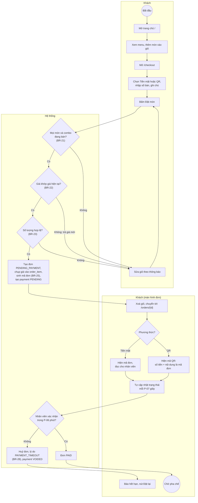
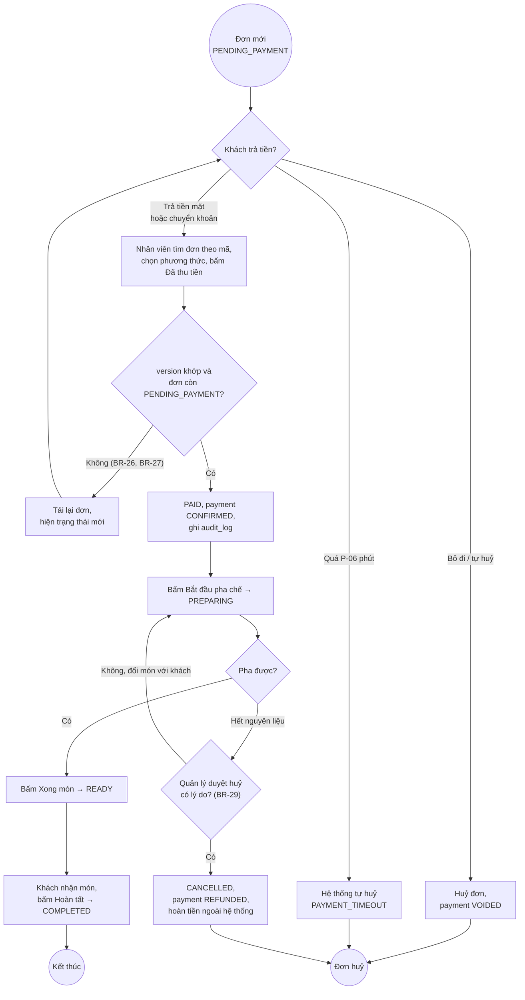
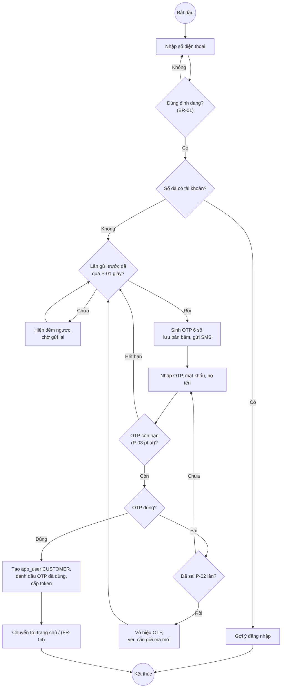
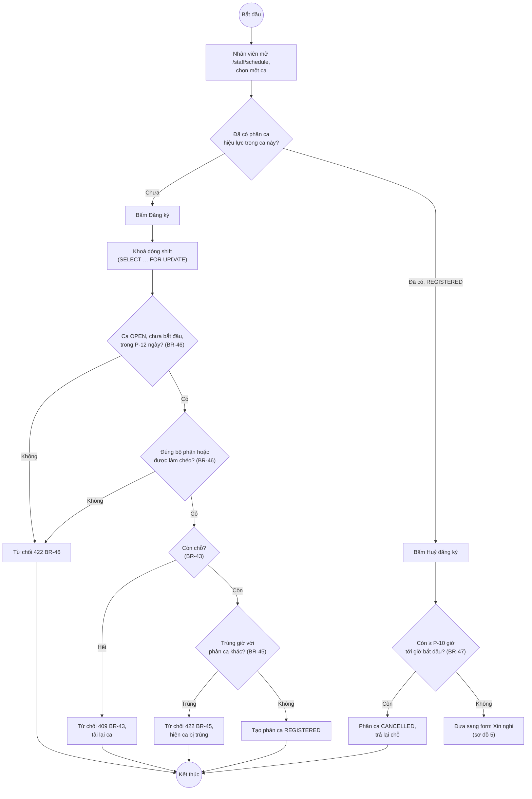
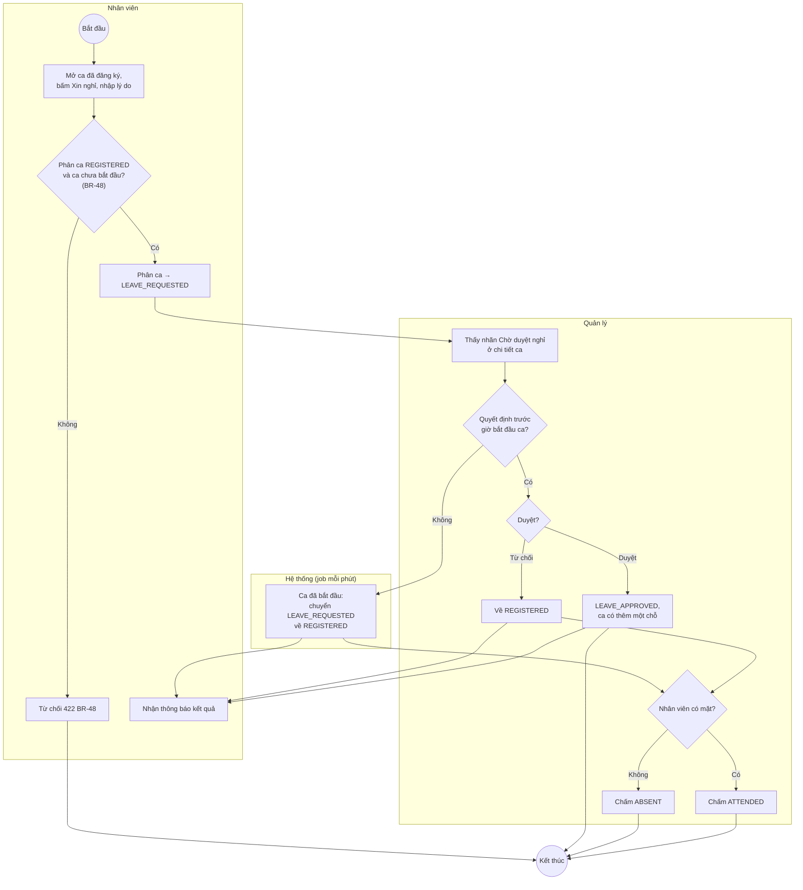
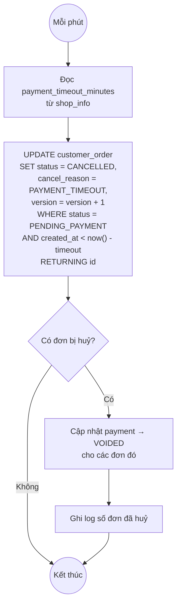
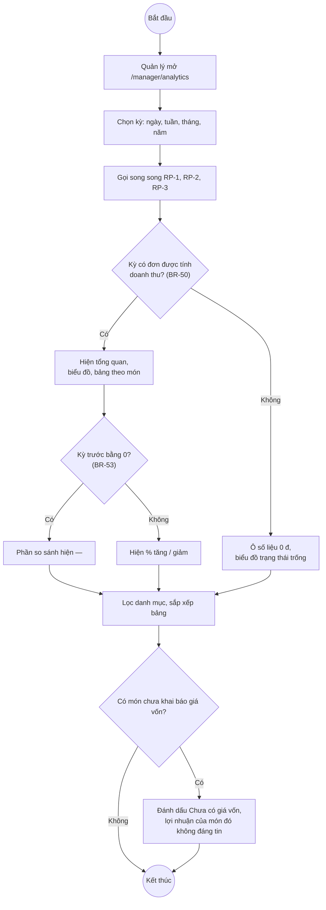

# 06 — Activity diagram

Mermaid chưa có loại sơ đồ activity riêng, nên các sơ đồ dưới đây dùng `flowchart`. Mỗi `subgraph` là một làn (swimlane) cho một actor hoặc hệ thống. Hình thoi là điểm rẽ nhánh, hình tròn là điểm bắt đầu và kết thúc.

## 1. Đặt món và thanh toán (UC-05, UC-07, UC-08)

**Điểm cần lưu ý**
- Bước "Bấm Đặt món" sinh `Idempotency-Key` một lần cho mỗi lần đặt. Nếu mất mạng thì gửi lại với cùng khoá, nên không cần vẽ nhánh "tạo trùng đơn" (BR-24).
- Khách tự huỷ được trong lúc chờ (UC-11), không vẽ ở đây để sơ đồ gọn. Xem sơ đồ 2.

## 2. Xử lý đơn tại quầy (UC-10, UC-11)

> "Đổi món với khách" không thay đổi dòng đơn trong hệ thống ở MVP. Nếu quán thường xuyên đổi món, cần thêm chức năng sửa đơn sau thanh toán (Q-06 trong [01-dac-ta.md](01-dac-ta.md#10-câu-hỏi-mở)).

## 3. Đăng ký tài khoản bằng OTP (UC-01)

## 4. Đăng ký ca và huỷ đăng ký (UC-20)

## 5. Xin nghỉ và duyệt nghỉ (UC-21, UC-22)

**Điểm cần lưu ý:** nhân viên bị từ chối nghỉ nhưng vẫn không tới thì bị chấm `ABSENT` và không được tính lương (BR-52). Quy định này cần được thông báo rõ cho nhân viên.

## 6. Tự huỷ đơn quá hạn thanh toán (BR-28)

Câu lệnh `UPDATE` có điều kiện trạng thái nên chạy lại hai lần vẫn cho đúng kết quả. Nếu nhân viên xác nhận thanh toán đúng lúc job chạy, chỉ một trong hai `UPDATE` thành công. Bên thua nhận 409 và tải lại đơn.

## 7. Xem báo cáo doanh thu (UC-23)

