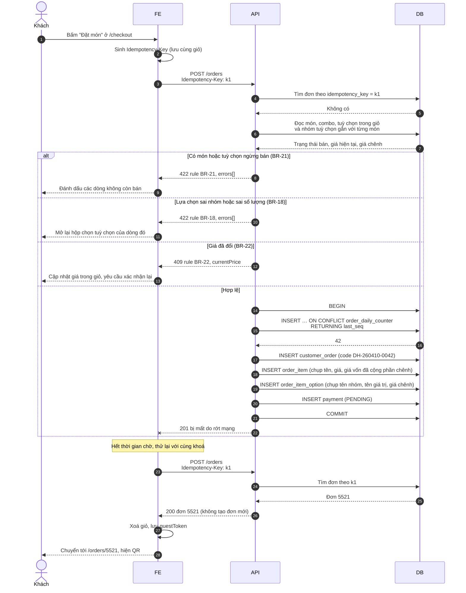
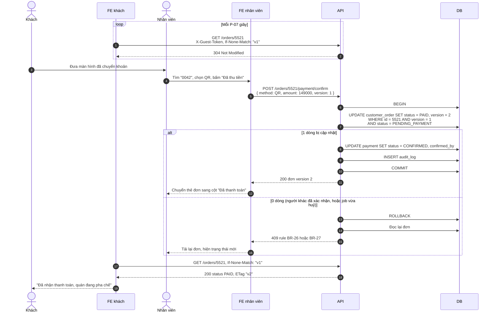
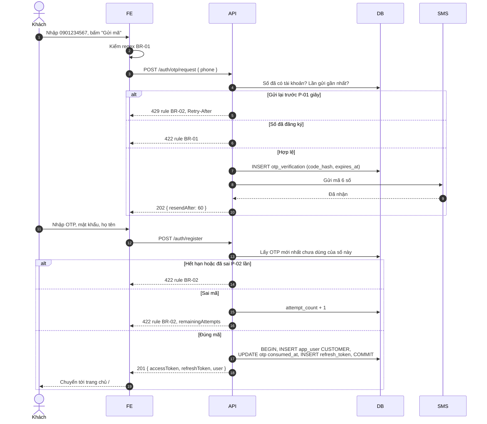
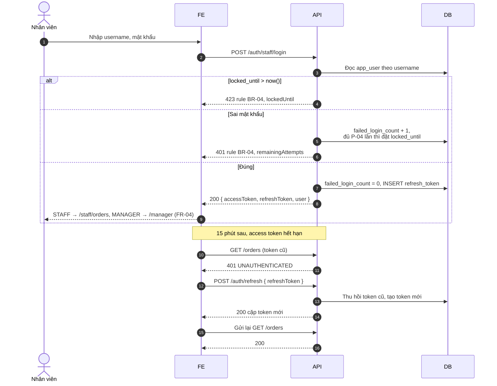
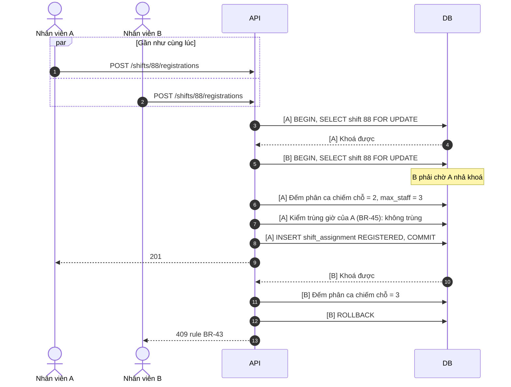
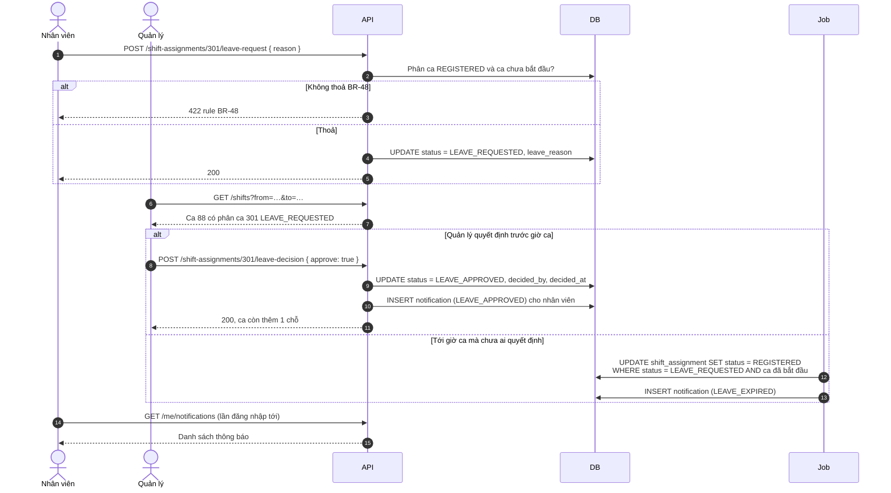
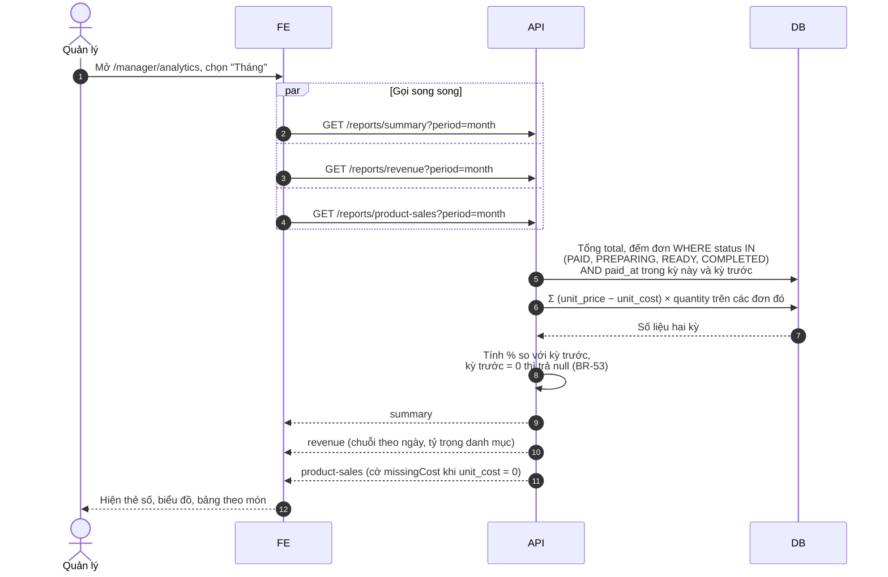

# 07 — Sequence diagram

Các participant dùng chung:

| Tên | Vai trò |
|---|---|
| `FE` | Frontend Next.js chạy trên trình duyệt |
| `API` | Backend REST (`/api/v1`) |
| `DB` | PostgreSQL |
| `SMS` | Nhà cung cấp SMS gửi OTP |
| `Job` | Tiến trình nền chạy theo lịch |

## 1. Đặt món, mất mạng và gửi lại (UC-07, BR-21 → BR-25)

## 2. Theo dõi đơn và nhân viên xác nhận thanh toán (UC-08, UC-10)

## 3. Đăng ký tài khoản bằng OTP (UC-01)

> Nếu SMS lỗi, API vẫn đã lưu OTP. Nên trả 502 và **không** tính lần gửi đó vào P-01, để khách bấm gửi lại ngay được.

## 4. Đăng nhập nhân viên và làm mới token (UC-02, BR-04)

## 5. Hai nhân viên tranh chỗ cuối của một ca (UC-20, BR-43)

## 6. Xin nghỉ, duyệt nghỉ và thông báo (UC-21, BR-42, BR-48)

## 7. Báo cáo tổng quan (UC-23, BR-50 → BR-53)

